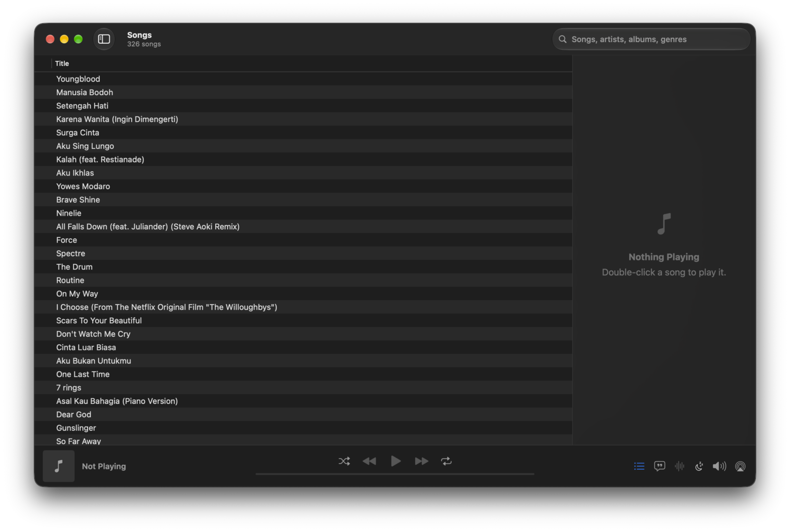
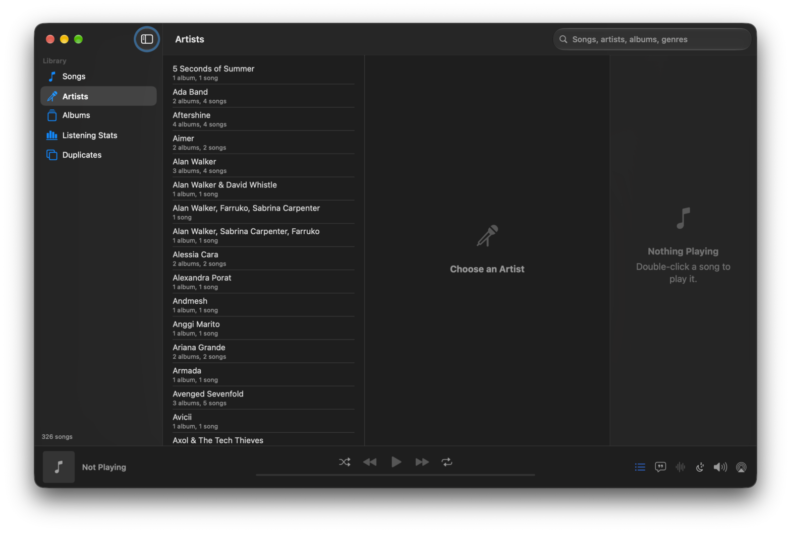
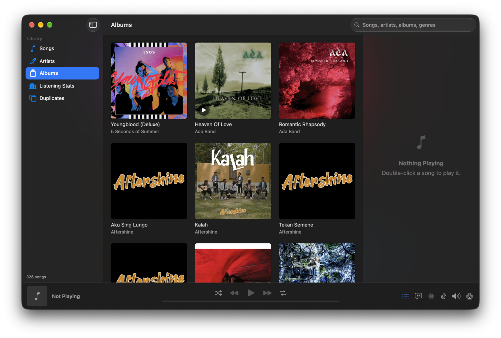
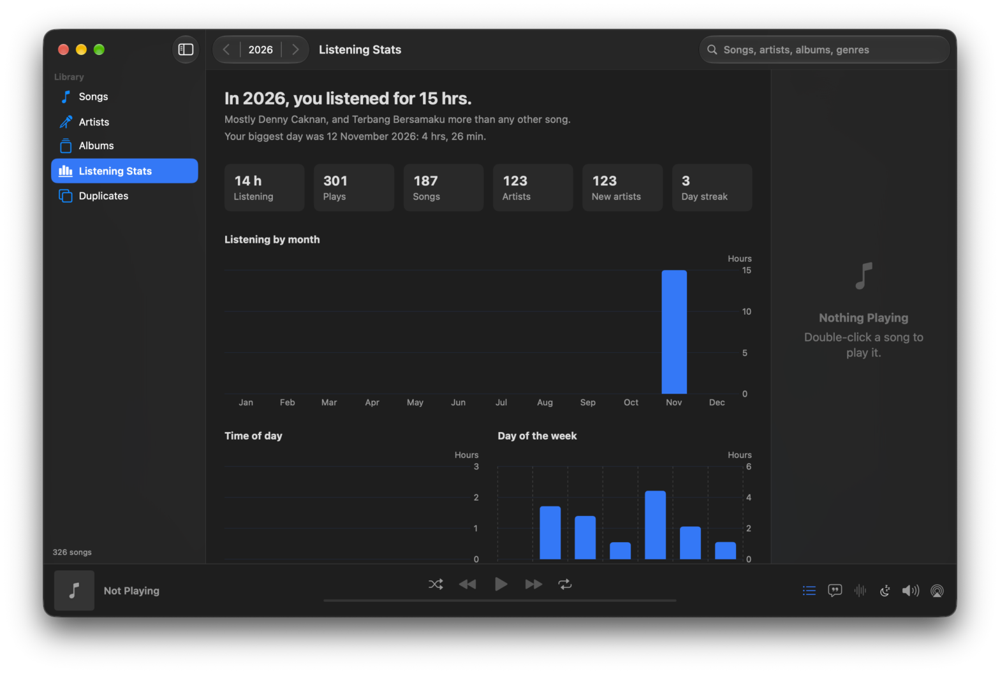
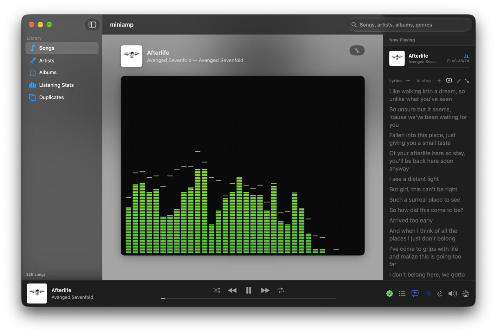
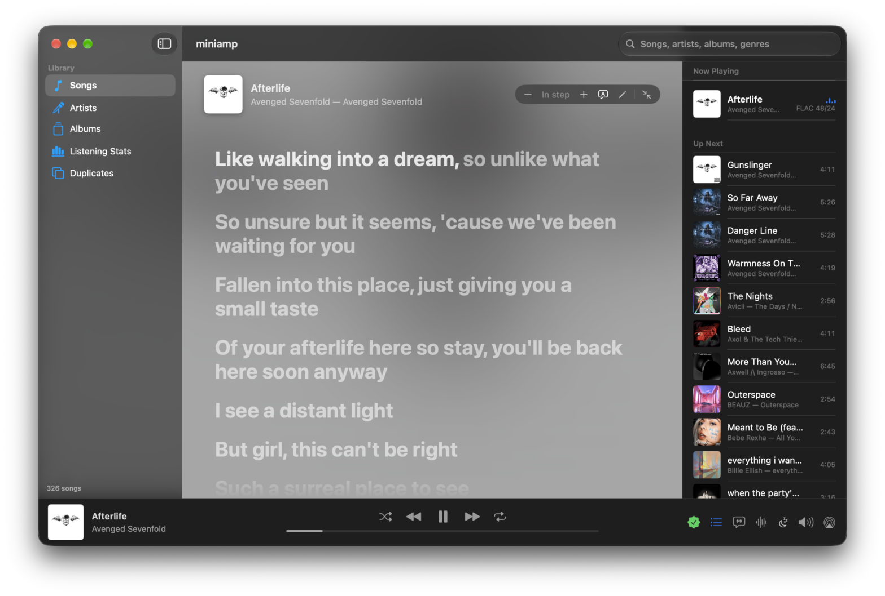

# miniamp design

The plan for redesigning miniamp's interface: modern macOS, Apple Music's layout taken further, delivered phase by phase so the app stays usable after each one. Tracked as M10 in [ROADMAP.md](ROADMAP.md).

## Ground rules

- **macOS 15 stays the minimum.** Liquid Glass is used on macOS 26 and later, behind `#available`; macOS 15 keeps the current materials.
- **The quality indicator stays honest and visible** in every layout: bit-perfect, resampled, or DSP.
- **No new cost.** `make app-bench` runs before Phase 0 and after each phase; idle and playing CPU mustn't rise.
- **Track lists stay `NSTableView`.** Restyled, not rewritten.
- **Local only.** Nothing in the redesign needs the network (no artist photos from a service).

## Where it starts

Screenshots from 18 November 2026 are in [docs/design/baseline-2026-11-18](docs/design/baseline-2026-11-18).

| | |
|---|---|
|  |  |
|  |  |
|  |  |

What they show:

- **The inspector costs a quarter of the window to say "Nothing Playing".** On Artists there are two empty states side by side.
- **Songs shows only the Title column**, with the rest of the row empty.
- **Artists is a plain text list, and every combination of credits is its own artist:** "Alan Walker", "Alan Walker & David Whistle", and "Alan Walker, Farruko, Sabrina Carpenter".
- **Albums is the strongest page**, but fits only three columns with the inspector open.
- **The cover wash turns grey on black-and-white covers**, and the unsung lyric lines (light grey on grey) are hard to read.
- **Full lyrics and the visualizer are titled "miniamp"** in the toolbar, where other pages have no window title.
- **The full views repeat the inspector:** Lyrics in the inspector beside full lyrics, Lyrics beside the visualizer.
- **The visualizer is a fixed box** in a larger space. The lyrics timing controls ("− In step +" and unlabeled icons) are hard to read.
- **The player bar has seven icons on its right**, and the quality badge is a green seal with no words. The seek bar shows no times.
- **Listening Stats rounds the total two ways:** "15 hrs" in the headline (`Listening.long` rounds) and "14 h" in the tile (`Listening.short` truncates).
- **The Time of day chart draws no bars** while its axis runs to 3 hours.
- **The charts are system blue**, ignoring the cover tint.
- **The sidebar toggle keeps a focus ring.**

## Phases

Phases 1 and 2 can go in either order; 1 first is suggested, since it's small, always on screen, and proves the glass.

| Phase | Size | Needs |
|---|---|---|
| 0 Foundations | S | none |
| 1 Player bar | S | 0 |
| 2 Browsing | L | 0 |
| 3 Now Playing | M | 0, 1 |
| 4 Secondary pages | M | 0 |
| 5 Polish | S, plus a share in each phase | all |

### Phase 0: Foundations

- `App/Sources/Design/`: tokens for spacing, corner radii, type, shadows, and how strongly each surface takes the cover tint.
- A `Glass` modifier: Liquid Glass on macOS 26 and later, the current material on 15.
- Components: `PageHeader`, `HeroHeader` (a large cover over a wash of its colours), `Shelf` (a horizontal row with See All), `ArtworkTile`, `PlayShuffleButtons`, `StatCard`.
- The 21 hard-coded colours and font sizes in views move to tokens.
- A wash that holds up on low-saturation covers: a dark neutral wash when the cover has little colour, and text contrast of at least 4.5:1 over it.
- Fixes from the baseline: the stats rounding, the empty Time of day chart, "miniamp" as the title of the full views, the sidebar toggle's focus ring, and Songs showing Artist, Album, and Time by default.
- A `-screenshot <page>` test hook, so each phase can be compared against the baseline.

**Done when:** nothing looks different except the fixes, every view uses the tokens, and the baseline bench is recorded.

### Phase 1: Player bar

- On macOS 26, a floating glass bar inset from the window edges. On macOS 15, a bar along the bottom as now.
- On the right: the quality badge, Up Next and Lyrics, volume, and output. The visualizer and sleep timer move into a `…` menu.
- The quality badge says what's playing in words ("FLAC 48/24") with a bit-perfect mark.
- The seek bar shows the time played and the time left.
- A larger cover that opens Now Playing (Phase 3), and a better Not Playing state than a grey square.

**Done when:** everything the bar did is still in reach, keyboard shortcuts included, and the bar fits an 860 pt window without truncating.

### Phase 2: Browsing

- **Artist credits are split** in the library, with a migration: "A, B & C" counts toward A, B, and C, and the song keeps its full credit. This comes before the Artist page.
- **Home**, the default page, in shelves: Recently Added, Recently Played, Top This Month, Rediscover (loved once, not played lately). All from `Plays` and `ListeningStats`; nothing new is stored.
- **Album page:** a hero header with a large cover over its wash, songs grouped by disc, a footer with the format, length, and year, and a More by This Artist shelf.
- **Artist page** in place of the list and table: a header from a mosaic of the artist's covers, top songs from play history, Albums, and Appears On.
- **Albums grid:** sort and filter (year, artist, recently added).
- **Songs table:** new row style, an optional artwork column, the playing row animated.
- **The inspector hides when nothing is playing.**

**Done when:** an album or artist is two clicks from Home, and the Albums grid scrolls smoothly at 10,000 tracks (`make library-bench`).

### Phase 3: Now Playing

- One full-window Now Playing: the large cover and controls on the left; lyrics, Up Next, or the visualizer on the right; the cover's wash behind it all.
- Full lyrics and the full visualizer become its modes. While it's open the inspector closes, so nothing shows twice.
- The visualizer fills its area.
- The lyrics timing controls get labels, or move into a menu.
- The inspector stays for quick access, in glass, with rows to match.
- Room for M9: autoplay's section in Up Next (#54) and the lyrics share card (#55), which reuses `HeroHeader` and the tint tokens.

**Done when:** synced lyrics still follow a seek, and app-bench CPU with lyrics and the visualizer is no higher than at the baseline.

### Phase 4: Secondary pages

- **Listening Stats:** headline cards, charts in the cover tint, and the top lists as shelves.
- **Duplicates:** each group side by side with covers and format, so choosing which copy to keep is easier.
- **Settings:** grouped forms in tabs (Playback, Library, Lyrics, Advanced). The tag and lyrics editors match.

### Phase 5: Polish and accessibility

- Motion for page changes, hero headers, and Now Playing.
- Reduce Motion, Reduce Transparency (glass becomes solid), and Increase Contrast.
- VoiceOver labels on every new component, and keyboard movement through shelves.
- Light and dark appearance, checked on macOS 15 as well as 27.

## Open questions

1. **Home or Songs as the default page?** Home is suggested; Songs stays one click away.
2. **A floating player bar on macOS 26:** judge it once Phase 1 is built. A bar along the bottom is an easy fallback.
3. **Artist images:** a mosaic of covers for now. Photos would need a network source, which goes against the local-only rule.
